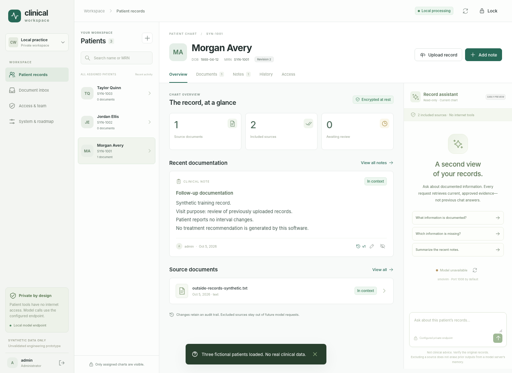
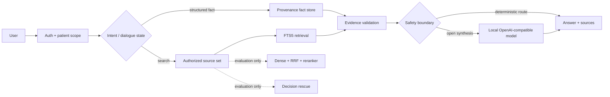

# Clinical AI Workspace

A local-first retrieval and evaluation system for longitudinal **synthetic** clinical records.

The project focuses on the engineering problems around an LLM—not on prompt demos: authorization before retrieval, evidence provenance, bounded conversation state, ranking evaluation, and conservative promotion of experimental retrieval methods.

> Portfolio / research prototype. Synthetic data only. Not a medical device or production EHR.



## Results

The checked-in benchmark contains 745 patient-scoped sources and expands 400 fixture questions into 1,100 hard retrieval queries.

| Metric | FTS5 baseline |
|---|---:|
| Recall@1 | **95.56%** |
| Recall@3 | **96.67%** |
| Recall@5 | **97.78%** |
| MRR | **0.9639** |
| nDCG@5 | **0.9674** |
| Cross-patient leakage | **0** |

The remaining misses are concentrated in observation/report retrieval, which is why dense retrieval, RRF, reranking, and decision-based rescue are kept as **evaluation-only** paths rather than silently replacing the lexical baseline.

Reproduce the baseline:

```bash
make benchmark
```

The generated report can be compared with [`benchmarks/fts5-baseline.json`](benchmarks/fts5-baseline.json).

## System design



The key invariant is simple: **authorization is resolved before candidate generation, embeddings, reranking, or model synthesis**.

## What is implemented

- FastAPI application with encrypted local workspace state and role/patient access checks.
- Patient-scoped SQLite FTS5 retrieval with deterministic normalization.
- Provenance-bound fact/event extraction with source version, content hash, quote, and offset validation.
- Per-user, per-patient, per-session encrypted conversation state for follow-up resolution.
- Local OpenAI-compatible model adapter with fail-closed remote access controls and bounded context.
- Evaluation-only dense embeddings, Reciprocal Rank Fusion, cross-encoder reranking, and decision/rescue components.
- Reproducible hard-retrieval metrics: Recall@k, MRR, nDCG@5, latency, and cross-patient leakage.
- Focused tests for authorization, retrieval isolation, dialogue state, provenance, medication-event search, model runtime, and retrieval experiments.

## Repository

```text
app/              application + retrieval/evaluation components
frontend/         React source
scripts/          run, benchmark, and public-release checks
tests/            focused unit/integration tests
synthetic-data/   compact benchmark fixture only
benchmarks/       checked-in reference metric report
docs/             architecture, evaluation, and one UI image
```

Historical release notes, migration reports, duplicate benchmark dumps, FHIR export files, and one-off verifier scripts are intentionally excluded from the public portfolio version.

## Quick start

Python 3.12+ is recommended.

```bash
python -m venv .venv
source .venv/bin/activate
pip install -r requirements.txt
cp .env.example .env
make test
make benchmark
make run
```

Open `http://127.0.0.1:8000`, create a local vault/account, and load the built-in synthetic examples.

The application can run without an LLM server for deterministic record workflows. Open-ended synthesis uses an optional local OpenAI-compatible endpoint such as `llama.cpp`.

### Optional retrieval experiments

```bash
pip install -r requirements-ml.txt
python scripts/evaluate_retrieval.py --hybrid --json-output runs/hybrid.json
```

Models must already be available locally; the retrieval adapters are configured not to fall back to network downloads at inference time.

## Engineering choices

**Evidence is not memory.** Conversation history can resolve references such as “what dose?”, but previous assistant text never becomes chart evidence.

**Rank quality matters.** Recall@5 alone is not enough to promote a retrieval candidate. The evaluation also tracks MRR, nDCG, latency, and leakage.

**Scope is non-negotiable.** Experimental retrievers receive only the already-authorized patient/source set. Cross-patient content is treated as a security failure, not a ranking error.

**Deterministic routes are preferred when possible.** Structured chart facts and safety-sensitive boundaries do not require an LLM call.

**Failed experiments stay failed.** Semantic/decision paths are present for evaluation but are not advertised as production improvements unless they pass the metric and isolation gates.

## Documentation

- [`docs/architecture.md`](docs/architecture.md) — request path, trust boundaries, memory, and model/runtime design.
- [`docs/evaluation.md`](docs/evaluation.md) — benchmark construction, metrics, failure analysis, and promotion criteria.

## Scope

This repository demonstrates applied-AI systems engineering: retrieval, evaluation, state, provenance, authorization, and local model integration. It does **not** claim clinical validation, HIPAA certification, foundation-model training, or superiority of a learned retriever over the current lexical baseline.
